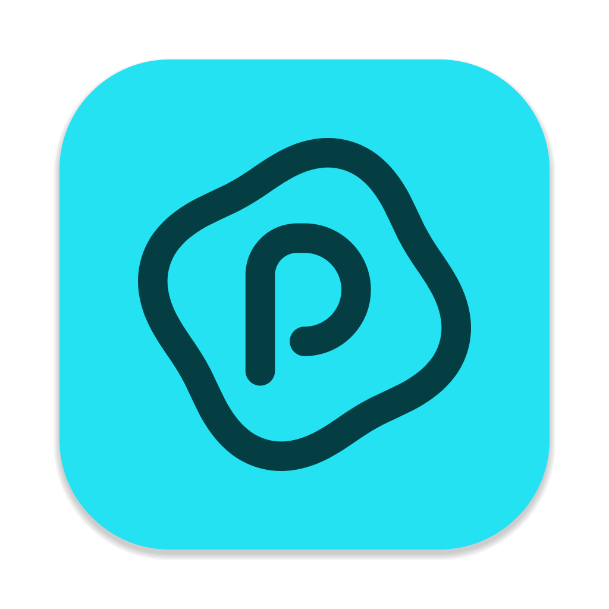

<h1 align="center">
  <br>
    <a href="https://github.com/DonutWare/Polder"></a>
  <br>
  Polder
  <br>
</h1>

<h4 align="center">A cross-platform synchronization platform backend built in <a href="https://go.dev/" target="_blank">Go</a>, with the frontend built on top of <a href="https://flutter.dev/" target="_blank">Flutter</a>.</h4>

<p align="center">
  <a href="#key-features">Key Features</a> •
  <a href="#screenshots">Screenshots</a> •
  <a href="#planned-features">Planned Features</a> •
  <a href="#download">Download</a> •
  <a href="#how-to-contribute">Contributing</a> •
  <a href="#credits">Credits</a> •
  <a href="#license">License</a>
</p>

<div align="center">
  
  [](https://github.com/DonutWare/Polder/actions/workflows/build.yml)
  [](https://github.com/DonutWare/Polder/releases/latest)
  [](https://github.com/DonutWare/Polder/releases/latest)
  [](https://conventionalcommits.org)
  
</div>


## Key Features

* Synchronise - For desktop keep any folder in sync for mobile you can auto upload files like pictures
* Versioning - Keep versions of any file edits with custom retention periods
* Trash - Files are never removed entirely use trash to recover files remove by accident
* Notes - Create a knowledgedatabase link notes inside of another note
* Collabora online support - Edit documents directly on all platforms.
* Platforms
  - Android
  - Web + Docker
  - macOS
  - Windows 
  - iOS 
  - Linux 
 
## Screenshots

## Planned Features

* Virtual file system
* Sharing urls
* Groups/Collaborations
* WebDAV
* 

## Download

The latest executables for Windows, macOS, Linux, iOS, Android and Web can be found on the [releases page](https://github.com/DonutWare/Polder/releases).

You can pull the Docker version using the following tags: ```ghcr.io/donutware/polder:latest```. or ```ghcr.io/donutware/polder:nightly```

> [!WARNING]
> (Windows) Some flutter applications are marked as false positives by windows defender for more info see [this issue](https://github.com/DonutWare/Polder/issues/197#issuecomment-2568906874).

## How to Contribute
Interested in contributing? Here are a couple of ways you can help:

### 🐛 Reporting Bugs
- Before reporting a bug, **please ensure** that the issue hasn't been reported already.
- When submitting a bug report, provide detailed steps on how the bug can be reproduced. This will help us to understand and fix the issue faster.
- Bug reports are appreciated and very helpful!

### 🚀 Submitting Pull Requests
- **Pull requests are always welcome!** 
- For new features or large changes, please open a discussion or issue first to ensure that no one else is already working on it.
- **Keep pull requests short and focused**: try to avoid fixing multiple issues in a single pull request. This helps make the review process smoother and quicker.

<!-- ### 🌐 Translations 
<a href="https://hosted.weblate.org/engage/Polder/">

</a>

Thank you for helping to make this project better! 🙌 -->

## Credits

This software uses the following open source packages:
- [Flutter](https://flutter.dev/)
- [Go](htt[s://go.dev])

## License

This project is licensed under the GNU Affero General Public License v3.0. More information about the license can be found in [this file](./LICENSE).
